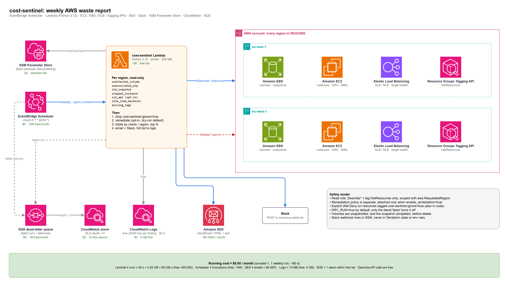
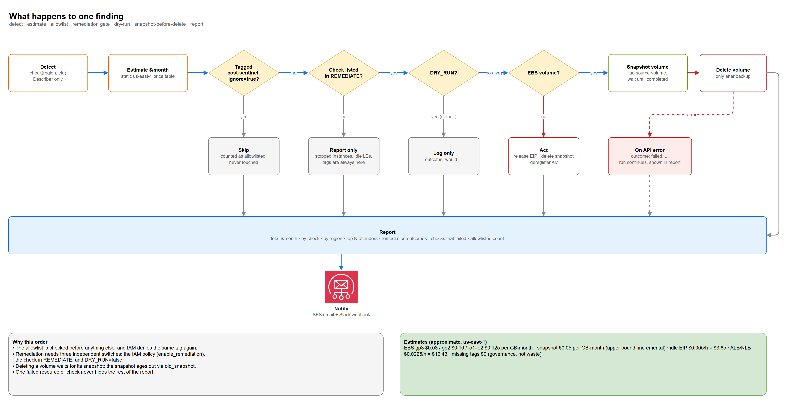
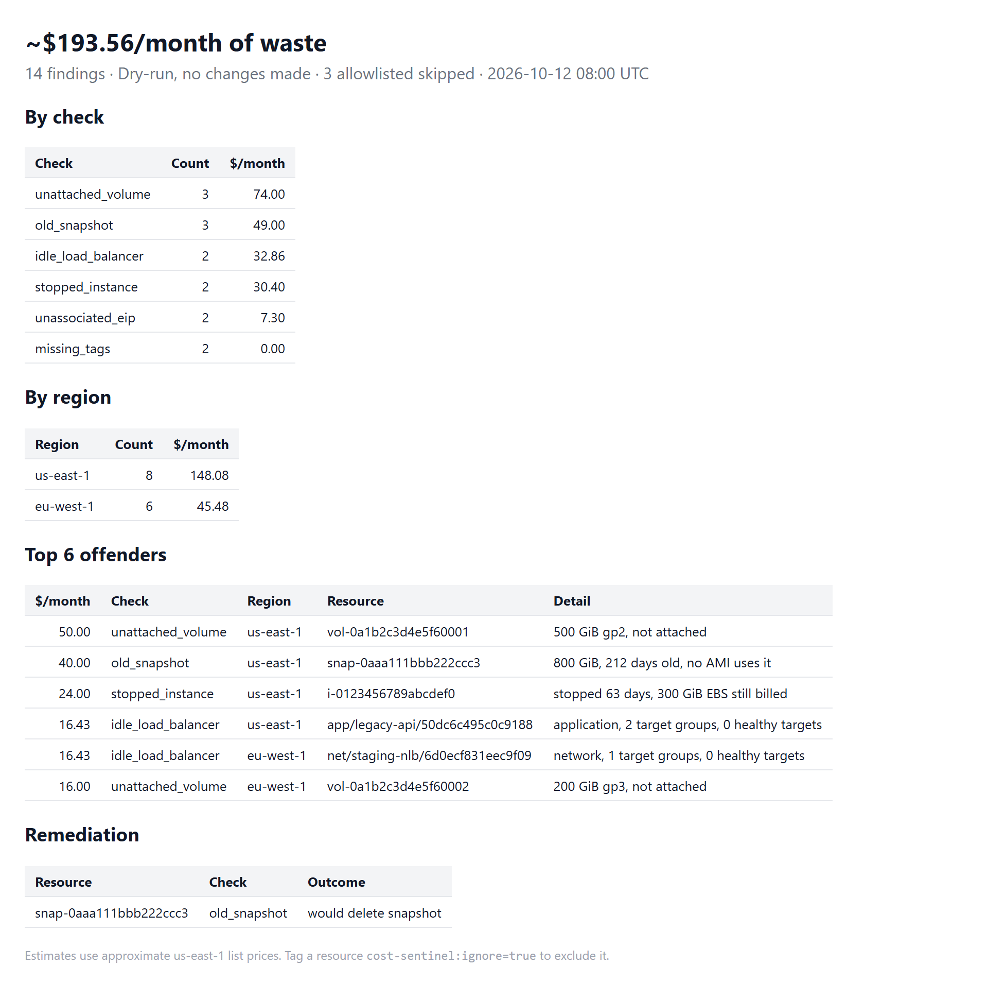

# cost-sentinel

A scheduled AWS Lambda that finds forgotten and wasteful resources across your regions, estimates what they cost per month, and sends a weekly report. Cleanup is optional, off by default, and dry-run first.


-2EA44F)
[](LICENSE)
[](https://github.com/andresazcona/cost-sentinel/actions/workflows/ci.yml)





Diagram source: [`docs/diagrams/cost-sentinel.drawio`](docs/diagrams/cost-sentinel.drawio), generated by [`gen_drawio.py`](docs/diagrams/gen_drawio.py). Nothing here has been deployed; the Terraform is validated, never applied.

## Problem and goals

Cloud bills grow through leftovers: a volume whose instance was terminated, an Elastic IP nobody released, snapshots from 2023, a load balancer with no targets. Each is small; together they are a steady leak, and nobody owns the cleanup.

- Find the usual suspects in every configured region with read-only calls.
- Put a rough dollar figure on each, so the report can be sorted by impact.
- Report weekly by email (SES) and/or Slack, totals by check and region, top N offenders.
- Optionally clean up the safe categories, never anything marked `cost-sentinel:ignore=true`, and back up volumes before deleting them.
- Cost about nothing to run, and be fully testable without an AWS account.

## Sample report

Rendered from made-up data by [`docs/sample/gen_sample.py`](docs/sample/gen_sample.py) using the real report code (plaintext twin: [`report.txt`](docs/sample/report.txt)).



## Checks

Prices are approximate on-demand list prices for **us-east-1**, kept in one small table at the top of [`checks.py`](src/cost_sentinel/checks.py). Other regions are typically 0-30% higher, so treat every figure as order-of-magnitude. The point is ranking, not invoicing.

| Check | What it finds | How savings are estimated | Auto-remediation |
| --- | --- | --- | --- |
| `unattached_volume` | EBS volumes in state `available` | size (GiB) x per-GB price by type (gp3 $0.08, gp2 $0.10, io1/io2 $0.125, st1 $0.045, sc1 $0.015) | Yes: snapshot, wait until completed, then delete |
| `unassociated_eip` | Elastic IPs with no association | $0.005/h x 730 h = $3.65 | Yes: release |
| `old_snapshot` | Snapshots older than `SNAPSHOT_MAX_AGE_DAYS` (90) that no AMI uses | size x $0.05 per GB-month (upper bound, snapshots are incremental) | Yes: delete |
| `stopped_instance` | Instances stopped for more than `STOPPED_MAX_DAYS` (30) | their attached EBS volumes, priced like the volume check (a stopped instance costs nothing else) | No: report only |
| `idle_load_balancer` | ALB/NLB/GWLB with no healthy targets (none registered, or all unhealthy) | base hourly charge: $0.0225 x 730 = $16.43 (GWLB $0.0125) | No: report only |
| `missing_tags` | Resources lacking any of `REQUIRED_TAGS` (default `owner`, `cost-center`), via the Resource Groups Tagging API | $0, this is governance, not waste | No: report only |
| `old_ami` (opt-in, `CHECK_AMIS=true`) | Own AMIs older than `AMI_MAX_AGE_DAYS` (180) that no instance uses | backing snapshots, as above | Yes: deregister (snapshots are kept and picked up by `old_snapshot`) |

## Architecture walkthrough

1. **EventBridge Scheduler** invokes the Lambda weekly (`cron(0 8 ? * MON *)`, UTC by default) asynchronously.
2. The **Lambda** loops over `REGIONS` and runs every check as a plain function `(region, cfg) -> list[Finding]`. A check that fails (access denied, region not enabled) is recorded in the report and does not stop the others.
3. Findings tagged `cost-sentinel:ignore=true` are dropped and only counted.
4. If remediation is enabled for a check, the Lambda acts (or logs what it would do in dry-run).
5. The report is built once and sent by **SES** (HTML plus a text part) and/or **Slack**. The webhook URL is read at run time from an **SSM SecureString**; it never appears in Terraform state or environment variables.
6. Every finding is logged as one JSON line to **CloudWatch Logs** (30 days), so the full list is queryable even though the report only shows the top N.
7. Failed runs and failed scheduler deliveries land in an **SQS dead-letter queue**; a **CloudWatch alarm** fires when its depth is above zero.

## Safety model

Remediation needs three independent switches, all of which default to off:

1. `enable_remediation = true` in Terraform attaches the remediation IAM policy. Without it the role simply cannot delete anything.
2. The check must be listed in `REMEDIATE` (`remediate_checks`). Stopped instances, load balancers and missing tags cannot be listed at all: the handler rejects them at start-up.
3. `DRY_RUN=false`. Anything other than the literal string `false` keeps dry-run on, so a typo cannot start deleting.

On top of that:

- **Allowlist enforced twice.** Code skips resources tagged `cost-sentinel:ignore=true`, and the remediation policy carries an explicit IAM `Deny` on the same tag, so a bug in the code still cannot delete them.
- **Backup first.** A volume is snapshotted (tagged with its source volume) and the Lambda waits for the snapshot to complete before deleting it. If the snapshot fails, the volume stays.
- **Least privilege.** The read policy is `Describe*` plus `tag:GetResources` only, limited to the configured regions with `aws:RequestedRegion`. Destructive actions live in a separate policy behind a variable.
- **Failure isolation.** One failing resource or check shows up in the report and never hides the rest.
- **Webhook hygiene.** The Slack URL must start with `https://`, and is read from SSM at run time.

## Key decisions

- **Plain functions, one registry.** Each check is a small function returning `Finding` objects; adding a check is one function and one list entry. No plugin system, no base classes.
- **Static price table instead of the Pricing API.** The Pricing API is slow, region-quirky, and needs more IAM. Rough numbers are enough to rank findings; the trade-off is that estimates drift from the bill.
- **Describe-based detection, not Cost Explorer.** Cost Explorer lags by a day, costs $0.01 per API call, and cannot tell you *which* resource is idle. Describe calls are free and exact.
- **Report-only for anything stateful.** Deleting an instance or load balancer needs someone who knows what it is for. Only resources that can be backed up (volumes) or are trivially recreatable (EIPs) get remediation.
- **SES and Slack both optional.** Either, both, or neither (CloudWatch Logs only) works; the channel is chosen by which variables are set.
- **Webhook in SSM, not env vars.** Keeps the secret out of Terraform state and the Lambda console; costs one `GetParameter` call a week.
- **Scheduler over EventBridge rules.** Time zone support and a built-in retry policy with a dead-letter queue, at the same cost.
- **Single Lambda, sequential regions.** A weekly job with ~60 s of work does not justify Step Functions or a fan-out. Revisit if scanning many regions pushes against the 15-minute limit.
- **arm64 and boto3 from the runtime.** Cheaper per GB-second; no layers or vendored dependencies, the zip is a few KB.

## Repository layout

```
src/cost_sentinel/
  config.py      env vars -> frozen Config (safe defaults)
  checks.py      price table, Finding, one function per check
  remediate.py   opt-in actions, dry-run, allowlist guard
  report.py      totals by check/region, top N, text and HTML
  handler.py     Lambda entry point: run checks, remediate, notify
tests/           moto-backed tests, no AWS credentials needed
infra/           Terraform: Lambda, Scheduler, IAM, DLQ, alarm, logs
docs/diagrams/   .drawio source, generator, PNG exports
docs/sample/     sample report generator, HTML, text and PNG
.github/workflows/ci.yml
```

## Run and validate locally

```bash
python -m venv .venv && . .venv/bin/activate      # Windows: .venv\Scripts\activate
pip install -r requirements-dev.txt

ruff check . && ruff format --check .
pytest -q                                          # moto, fully offline

cd infra
terraform init -backend=false
terraform validate
terraform fmt -check -recursive
```

The tests cover every check, the allowlist tag, dry-run versus live remediation (including snapshot-before-delete), report totals, a failing check not hiding others, and the safe config defaults.

To regenerate the sample and the diagrams:

```bash
PYTHONPATH=src python docs/sample/gen_sample.py
python docs/diagrams/gen_drawio.py
```

### Configuration

Terraform variables map to Lambda environment variables (see [`infra/example.tfvars`](infra/example.tfvars)):

| Variable | Env var | Default |
| --- | --- | --- |
| `regions` | `REGIONS` | `["us-east-1"]` |
| `required_tags` | `REQUIRED_TAGS` | `["owner", "cost-center"]` |
| `snapshot_max_age_days` / `stopped_max_days` / `ami_max_age_days` | `SNAPSHOT_MAX_AGE_DAYS` / `STOPPED_MAX_DAYS` / `AMI_MAX_AGE_DAYS` | 90 / 30 / 180 |
| `check_amis` | `CHECK_AMIS` | `false` |
| `dry_run` | `DRY_RUN` | `true` |
| `enable_remediation` | (attaches the remediation policy) | `false` |
| `remediate_checks` | `REMEDIATE` | `[]` |
| `ses_sender`, `ses_recipients` | `SES_SENDER`, `SES_RECIPIENTS` | empty (no email) |
| `slack_webhook_parameter` | `SLACK_WEBHOOK_PARAM` | empty (no Slack) |

## Running cost

Estimate for one weekly run (~60 s, 256 MB), two regions, in us-east-1 pricing. Not deployed; this is arithmetic, not a bill.

| Item | Usage per month | Free tier / unit price | Cost |
| --- | --- | --- | --- |
| Lambda | 4 runs x 60 s x 0.25 GB = 60 GB-s | 400,000 GB-s free | $0.00 |
| EventBridge Scheduler | 4 invocations | 14,000,000 free | $0.00 |
| SES | 4 emails | $0.10 per 1,000 = $0.0004 | ~$0.00 |
| CloudWatch Logs | < 10 MB | 5 GB ingestion free | $0.00 |
| SQS DLQ | ~0 messages | 1,000,000 requests free | $0.00 |
| CloudWatch alarm | 1 alarm | 10 alarms free | $0.00 |
| SSM Parameter Store | 1 standard SecureString, 4 reads | standard tier is free | $0.00 |
| EC2 / ELB / Tagging Describe calls | a few hundred | no charge | $0.00 |
| **Total** | | | **about $0.00** |

Outside the free tier the same workload is still a few cents. With remediation on, each deleted volume leaves a backup snapshot that costs $0.05 per GB-month until `old_snapshot` ages it out and deletes it.

## What I'd add next

- Idle RDS instances and NAT gateways with no traffic (needs CloudWatch metrics; the biggest remaining line items).
- Multi-account scanning through an assumed role per account, with a combined report.
- Pricing API lookup with a cached table, to replace the static one outside us-east-1.
- A `DRY_RUN` approval flow: post the proposed deletions to Slack and apply only after a reaction.
- Findings to S3 or Athena for trend tracking ("is the leak growing?").

## License

MIT, see [LICENSE](LICENSE).
